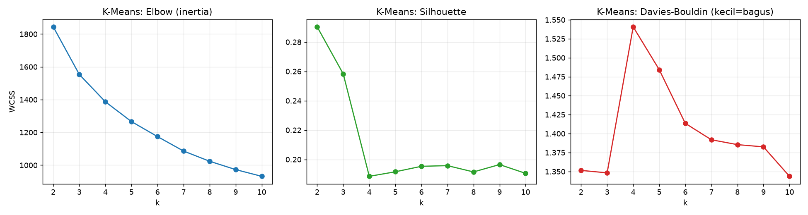
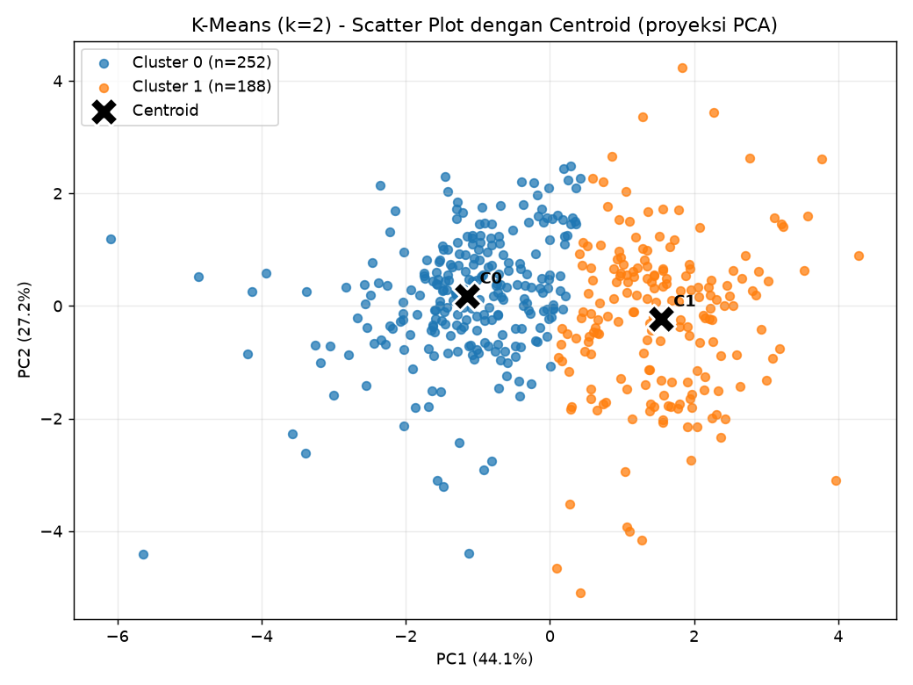
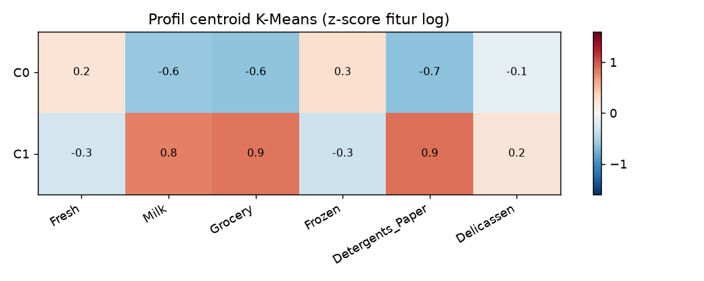
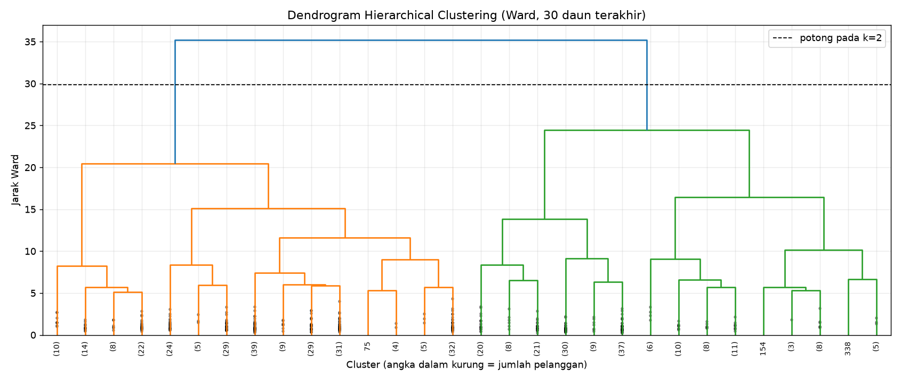
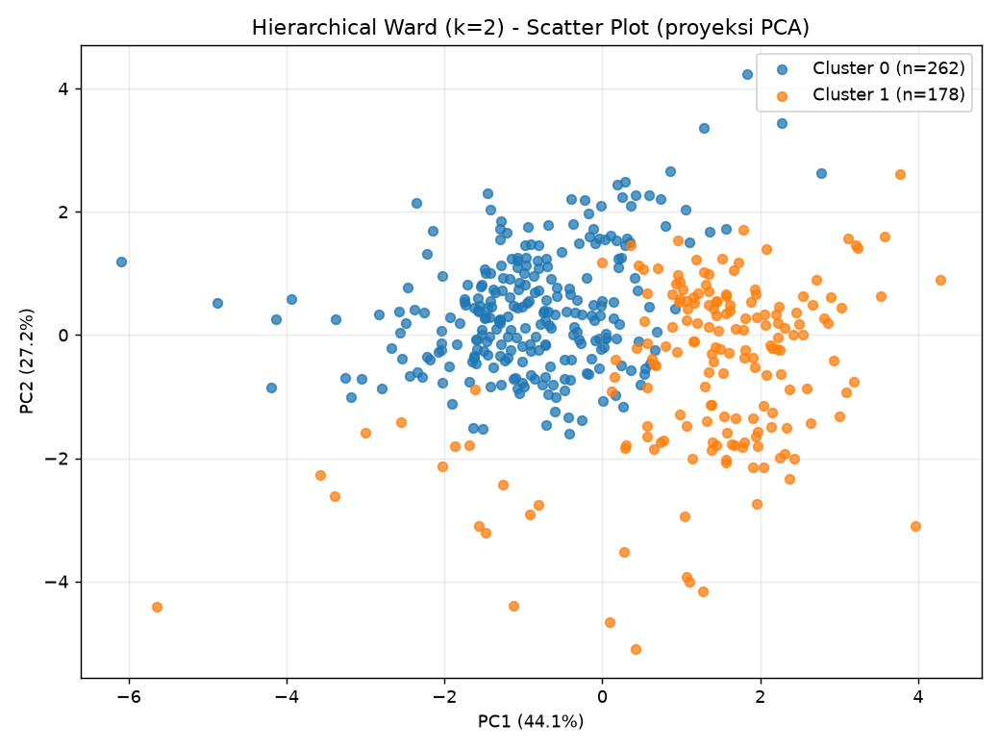
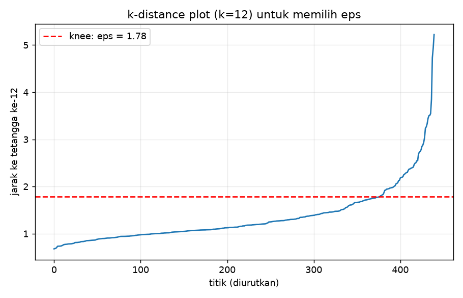
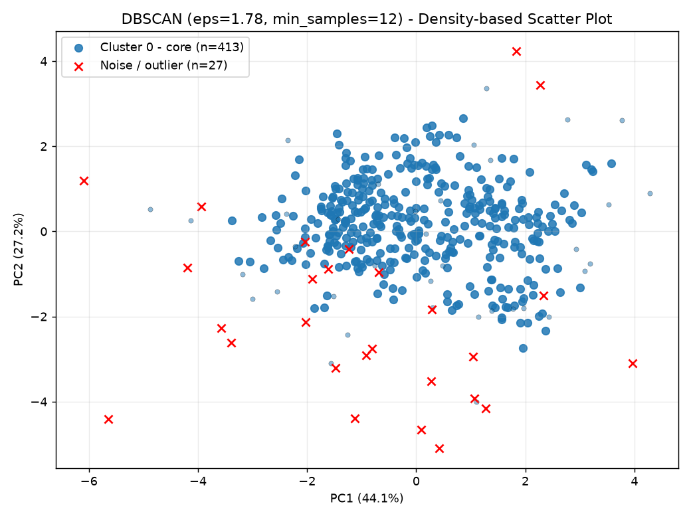
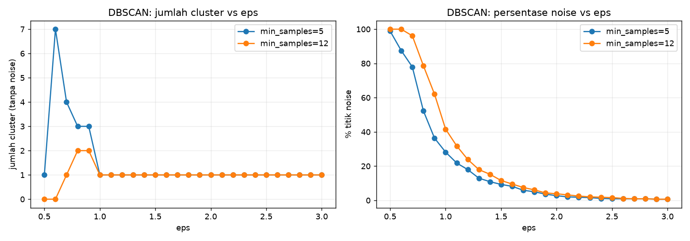
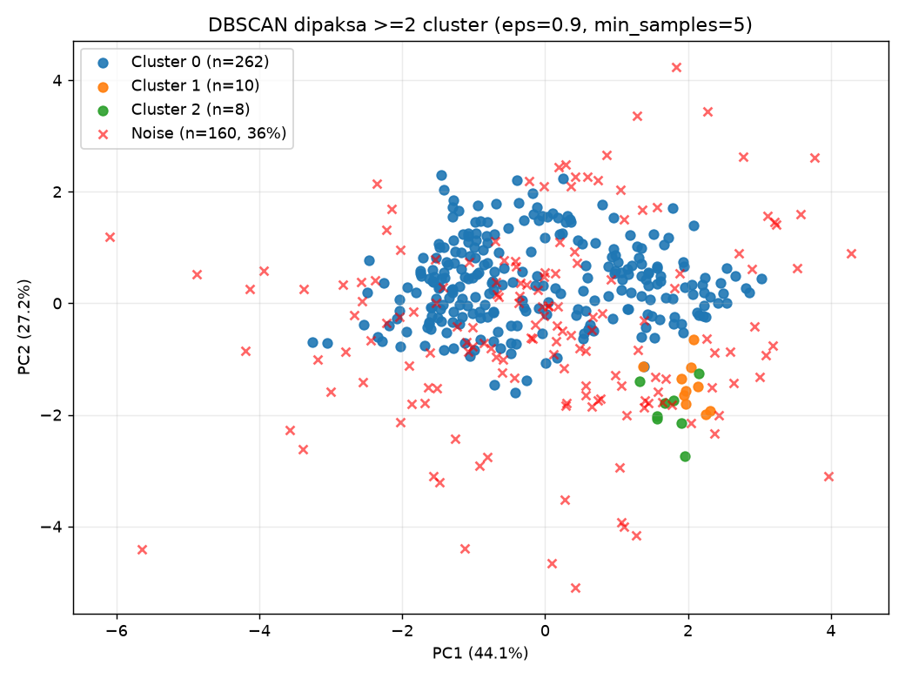
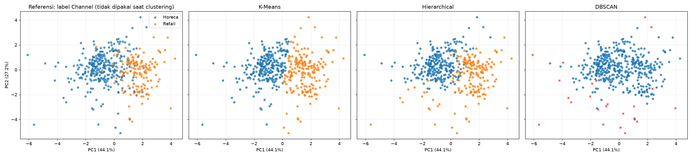

# Perbandingan Algoritma Clustering pada UCI Wholesale Customers Dataset

**Tugas Kuliah — Machine Learning | Clustering**

Proyek ini membandingkan tiga algoritma clustering — **K-Means**, **Hierarchical Agglomerative (Ward)**, dan **DBSCAN** — pada dataset *Wholesale Customers* dari UCI Machine Learning Repository. Tujuannya adalah memahami karakteristik tiap algoritma, mengevaluasinya dengan metrik internal dan eksternal, serta menentukan metode yang paling sesuai untuk data distribusi grosir ini.

---

## Daftar Isi

1. [Dataset](#1-dataset)
2. [Pra-proses](#2-pra-proses)
3. [Metode dan Hasil](#3-metode-dan-hasil)
   - [K-Means](#31-k-means)
   - [Hierarchical Agglomerative (Ward)](#32-hierarchical-agglomerative-ward)
   - [DBSCAN](#33-dbscan)
4. [Perbandingan Metrik](#4-perbandingan-metrik)
5. [Analisis dan Kesimpulan](#5-analisis-dan-kesimpulan)
6. [Cara Menjalankan](#6-cara-menjalankan)
7. [Struktur Folder](#7-struktur-folder)
8. [Referensi](#8-referensi)

---

## 1. Dataset

| Atribut | Keterangan |
|---|---|
| **Sumber** | [UCI ML Repository — Wholesale customers (id 292)](https://archive.ics.uci.edu/dataset/292/wholesale+customers) |
| **Jumlah sampel** | 440 pelanggan distributor grosir |
| **Fitur clustering** | 6 fitur pengeluaran tahunan (m.u.) |
| **Kolom lain** | `Channel` dan `Region` — *tidak digunakan* saat clustering; hanya sebagai label referensi eksternal |

**Enam fitur pengeluaran tahunan:**
`Fresh`, `Milk`, `Grocery`, `Frozen`, `Detergents_Paper`, `Delicassen`

### Mengapa dataset ini tidak mudah dikluster?

Data asli memiliki distribusi yang **sangat miring ke kanan** (right-skewed), dengan nilai skewness berkisar antara 2,56 (Fresh) hingga 11,15 (Delicassen):

| Fitur | Skewness (asli) | Skewness (setelah log1p) |
|---|---|---|
| Fresh | 2,56 | −1,58 |
| Milk | 4,05 | −0,22 |
| Grocery | 3,59 | −0,67 |
| Frozen | 5,91 | −0,35 |
| Detergents\_Paper | 3,63 | −0,24 |
| Delicassen | 11,15 | −1,09 |

Kondisi ini disertai banyak outlier dan **tidak ada celah kepadatan yang jelas** antar kelompok pelanggan, sehingga tidak ada satu pun algoritma yang menghasilkan cluster dengan struktur sangat kuat (silhouette terbaik hanya 0,29).

> [!NOTE]
> Kolom `Channel` (1 = Horeca, 2 = Retail) dan `Region` tidak dimasukkan ke dalam proses clustering. Kolom tersebut hanya digunakan sebagai pembanding eksternal (Adjusted Rand Index) setelah cluster terbentuk.

---

## 2. Pra-proses

```
Data mentah  →  log1p  →  StandardScaler  →  X (440 × 6)
                                          →  PCA 2D (hanya untuk visualisasi)
```

| Langkah | Alasan |
|---|---|
| **log1p** | Mereduksi skewness ekstrem (2,56 – 11,15) agar distribusi lebih mendekati normal |
| **StandardScaler** | Menyamakan skala antar fitur (mean = 0, std = 1) agar jarak Euclidean tidak didominasi fitur bernilai besar |
| **PCA 2D** | Hanya untuk keperluan visualisasi scatter plot; PCA 2 komponen menjelaskan **71,3% varians** total (PC1 44,1%, PC2 27,2%) |

---

## 3. Metode dan Hasil

### 3.1 K-Means

Pemilihan jumlah cluster optimal (k) menggunakan tiga metrik: *elbow* (inertia/WCSS), silhouette, dan Davies-Bouldin pada rentang k = 2 s.d. 10.



Silhouette tertinggi berada pada **k = 2** (sil = 0,290), sehingga k = 2 dipilih sebagai konfigurasi final.

**Hasil clustering (k = 2):**

| Cluster | n | Fresh | Milk | Grocery | Frozen | Detergents\_Paper | Delicassen | % Retail |
|---|---|---|---|---|---|---|---|---|
| C0 | 252 | 13.973 | 2.402 | 2.919 | 3.706 | 492 | 1.038 | 3% |
| C1 | 188 | 9.356 | 10.346 | 14.697 | 2.222 | 6.085 | 2.177 | 71% |

- **C0** (252 pelanggan): pengeluaran Fresh tinggi, produk olahan rendah → profil **Horeca** (restoran/hotel).
- **C1** (188 pelanggan): pengeluaran Milk, Grocery, dan Detergents\_Paper tinggi → profil **Retail** (toko eceran).





---

### 3.2 Hierarchical Agglomerative (Ward)

Metode *linkage* Ward dipilih berdasarkan perbandingan metrik internal pada k = 2:

| Linkage | Cophenetic | Silhouette |
|---|---|---|
| Ward | 0,484 | 0,258 |
| Complete | 0,654 | 0,322 |
| Average | 0,745 | 0,569 |
| Single | 0,649 | 0,570 |

> [!IMPORTANT]
> Silhouette linkage *average* (0,569) dan *single* (0,570) **bersifat semu**. Kedua metode ini menghasilkan satu cluster berisi hampir seluruh data (438 dan 439 titik) dan satu cluster berisi hanya 2 dan 1 titik (outlier). Pemisahan outlier secara trivial menggelembungkan nilai silhouette tanpa makna kluster yang sesungguhnya.

Meskipun Ward memiliki silhouette lebih rendah, pembagian klusternya (262 vs 178 titik) jauh lebih seimbang dan bermakna secara bisnis.



**Hasil clustering (Ward, k = 2):**

| Cluster | n | Fresh | Milk | Grocery | Frozen | Detergents\_Paper | Delicassen | % Retail |
|---|---|---|---|---|---|---|---|---|
| C0 | 262 | 15.016 | 3.390 | 3.674 | 4.188 | 617 | 1.553 | 4% |
| C1 | 178 | 7.561 | 9.338 | 14.247 | 1.429 | 6.215 | 1.484 | 74% |

Profil C0 dan C1 serupa dengan K-Means: C0 = Horeca, C1 = Retail.



---

### 3.3 DBSCAN

**Pemilihan eps:** Metode *k-distance plot* dengan `min_samples = 2 × dimensi = 12`. Titik *knee* (elbow) kurva terdeteksi secara otomatis pada **eps = 1,78**.



**Konfigurasi DBSCAN *knee* (eps = 1,78, min\_samples = 12):**
- Cluster terbentuk: **1** (secara teknis hanya satu cluster besar, tidak ada pemisahan bermakna)
- Noise / outlier: **27 titik (6,1%)**

Hasil ini menunjukkan bahwa data *Wholesale Customers* tidak memiliki celah kepadatan yang cukup untuk membentuk dua cluster yang terpisah secara density-based.



**Sensitivitas parameter (grid search eps × min\_samples):**



**DBSCAN dipaksa ≥ 2 cluster (eps = 0,9, min\_samples = 5):**

Konfigurasi dengan noise paling kecil yang masih menghasilkan ≥ 2 cluster adalah eps = 0,9, min\_samples = 5. Namun, konfigurasi ini menghasilkan **160 titik noise (36,4%)** — lebih dari sepertiga data dikategorikan sebagai outlier, yang mengindikasikan ketidaksesuaian fundamental antara algoritma berbasis kepadatan dengan karakteristik dataset ini.



---

## 4. Perbandingan Metrik

### Tabel Metrik Internal dan Eksternal

| Algoritma | Silhouette ↑ | Davies-Bouldin ↓ | Calinski-Harabasz ↑ | Jumlah Cluster | Noise | ARI vs Channel |
|---|---|---|---|---|---|---|
| **K-Means** | **0,2903** | 1,3515 | **189,05** | 2 | 0 | 0,5135 |
| Hierarchical (Ward) | 0,2585 | 1,6004 | 134,62 | 2 | 0 | **0,5392** |
| DBSCAN (knee, eps=1,78) | — | — | — | 1 | 27 (6,1%) | −0,0225 |
| DBSCAN (dipaksa, eps=0,9, ms=5) | 0,2741 | **0,8102** | 26,35 | 3 | 160 (36,4%) | 0,0281 |

> [!NOTE]
> Metrik internal DBSCAN dihitung dengan mengecualikan titik noise (label −1). DBSCAN *knee* tidak memiliki metrik karena hanya menghasilkan 1 cluster.

### Panel Perbandingan Visual



### ARI Antar Algoritma

| Pasangan Algoritma | ARI |
|---|---|
| K-Means vs Hierarchical (Ward) | 0,639 |
| K-Means vs DBSCAN (knee) | −0,002 |
| Hierarchical (Ward) vs DBSCAN (knee) | 0,026 |
| K-Means vs DBSCAN (dipaksa) | 0,036 |

**Persentase titik dengan label cluster sama antara K-Means dan Hierarchical Ward: 90,0%.**

---

## 5. Analisis dan Kesimpulan

### Kemiripan K-Means dan Ward

K-Means dan Hierarchical Ward menghasilkan partisi yang sangat serupa: 90% dari 440 titik memperoleh label cluster yang sama (ARI = 0,639). Keduanya secara konsisten memisahkan pelanggan Horeca (Fresh-dominated) dari pelanggan Retail (Milk/Grocery/Detergents-dominated), sejalan dengan label `Channel` asli (ARI vs Channel: 0,51 dan 0,54).

### Perbedaan Mendasar DBSCAN

DBSCAN dengan parameter optimal (*knee*) hanya membentuk **1 cluster** dan mengidentifikasi 27 titik (6,1%) sebagai outlier/noise. Ketika dipaksa menghasilkan ≥ 2 cluster, persentase noise melonjak hingga 36,4%. Hal ini mengindikasikan bahwa data *Wholesale Customers* **tidak memiliki celah kepadatan yang nyata** antar kelompok pelanggan — data tersebar secara kontinu tanpa pemisahan yang berbasis density. Dalam konteks ini, DBSCAN lebih efektif berfungsi sebagai **pendeteksi outlier** (27 titik, 6,1%) daripada sebagai alat segmentasi.

### Kesimpulan: K-Means (k=2) Paling Sesuai

**K-Means dengan k = 2** direkomendasikan sebagai metode terbaik untuk dataset ini, dengan alasan:

1. **Metrik internal terbaik:** Silhouette tertinggi (0,290) dan Calinski-Harabasz tertinggi (189,05) di antara algoritma yang menghasilkan cluster bermakna.
2. **Sebaran yang cukup bulat:** Setelah transformasi log1p dan standarisasi, sebaran data relatif isotropik sehingga asumsi K-Means (cluster berbentuk bulat) cukup terpenuhi.
3. **Centroid mudah ditafsirkan:** Profil centroid langsung mencerminkan perbedaan pengeluaran bisnis antara Horeca dan Retail.
4. **Keselarasan dengan label Channel:** ARI vs Channel sebesar 0,514 menunjukkan kesesuaian yang bermakna dengan kategori pelanggan nyata.

> [!WARNING]
> **Keterbatasan:** Nilai silhouette 0,29 mengindikasikan struktur cluster yang **lemah hingga sedang** — cluster saling tumpang tindih dan tidak terpisah dengan jelas. Hasil segmentasi perlu diinterpretasikan dengan hati-hati dan tidak boleh dianggap sebagai pemisahan yang mutlak. Ini adalah sifat intrinsik dataset, bukan kelemahan implementasi.

---

## 6. Cara Menjalankan

**Prasyarat:** Python 3.9 atau lebih baru, macOS/Linux.

```bash
# 1. Buat dan aktifkan virtual environment
python3 -m venv .venv
source .venv/bin/activate

# 2. Instal dependensi
pip install -r requirements.txt

# 3. Jalankan skrip utama
python clustering_wholesale.py
```

Skrip akan mengunduh data secara otomatis dari UCI ML Repository (memerlukan koneksi internet). Jika tidak tersedia, letakkan file `wholesale.csv` (*Wholesale customers data.csv*) di folder yang sama.

Semua gambar dan tabel hasil akan tersimpan di folder `output/`.

---

## 7. Struktur Folder

```
clustering_wholesale/
├── clustering_wholesale.py      # Skrip utama: pra-proses, clustering, evaluasi, visualisasi
├── requirements.txt             # Daftar dependensi Python
├── wholesale.csv                # Dataset (opsional, fallback jika tidak ada koneksi internet)
├── README.md                    # Laporan proyek ini
└── output/
    ├── ringkasan_metrik.csv             # Tabel metrik semua algoritma
    ├── profil_k-means.csv               # Profil centroid K-Means (rata-rata pengeluaran asli)
    ├── profil_hierarchical.csv          # Profil cluster Hierarchical Ward
    ├── profil_dbscan.csv                # Profil cluster DBSCAN
    ├── dbscan_grid.csv                  # Grid search sensitivitas parameter DBSCAN
    ├── 00_kmeans_pemilihan_k.png        # Elbow, silhouette, DB untuk pemilihan k
    ├── 01_kmeans_scatter_centroid.png   # Scatter plot K-Means dengan centroid (PCA)
    ├── 02_hierarchical_dendrogram.png   # Dendrogram Ward
    ├── 03_dbscan_kdistance.png          # k-distance plot untuk pemilihan eps
    ├── 04_dbscan_scatter.png            # Scatter DBSCAN (knee): core, border, noise
    ├── 04b_dbscan_scatter_dipaksa.png   # Scatter DBSCAN dipaksa ≥2 cluster
    ├── 05_hierarchical_scatter.png      # Scatter Hierarchical Ward (PCA)
    ├── 06_perbandingan_panel.png        # Panel 4-in-1: Channel + 3 algoritma
    ├── 07_kmeans_profil_heatmap.png     # Heatmap profil centroid K-Means (z-score)
    └── 08_dbscan_sensitivitas.png       # Sensitivitas jumlah cluster & noise vs eps
```

---

## 8. Referensi

- Cardoso, M. (2013). *Wholesale customers* [Dataset]. UCI Machine Learning Repository. [https://doi.org/10.24432/C5030X](https://doi.org/10.24432/C5030X)
- Ester, M., Kriegel, H.-P., Sander, J., & Xu, X. (1996). A density-based algorithm for discovering clusters in large spatial databases with noise. *KDD-96 Proceedings*, 226–231.
- Rousseeuw, P. J. (1987). Silhouettes: A graphical aid to the interpretation and validation of cluster analysis. *Journal of Computational and Applied Mathematics*, 20, 53–65.
- Ward, J. H. (1963). Hierarchical grouping to optimize an objective function. *Journal of the American Statistical Association*, 58(301), 236–244.

